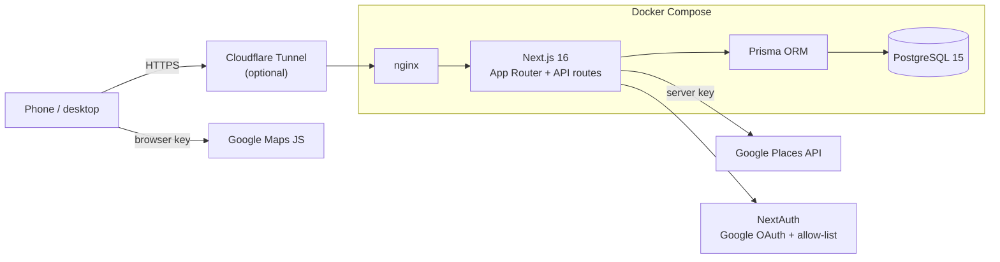
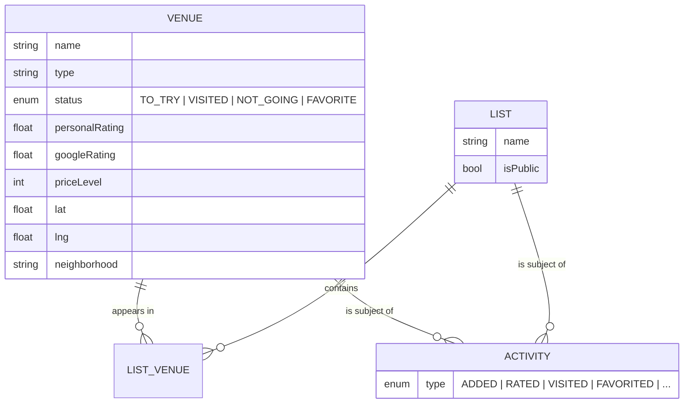

<div align="center">


<sub><a href="#-what-it-is">What it is</a> &nbsp;·&nbsp; <a href="#-features">Features</a> &nbsp;·&nbsp; <a href="#-architecture">Architecture</a> &nbsp;·&nbsp; <a href="#-data-model">Data model</a> &nbsp;·&nbsp; <a href="docs/SETUP.md">Setup guide</a></sub>

</div>

<br/>

> Every city-dweller keeps a mental list of "places I should try". This app makes it a real one:
> restaurants, coffee shops, pubs and bars in Bucharest, pulled from Google Places, tracked from *to try*
> to *favourite*, organised into lists, rated, and shown on a live map. Built to run on your own box, for you and the friends you invite.

## ◆ &nbsp;What it is

A full-stack Next.js App Router application with a PostgreSQL database, Google sign-in restricted to an
allow-list of accounts, and Google Places as the source of truth for venue details. It ships as three containers
(app, database, nginx) plus an optional Cloudflare Tunnel, so it can be reached from anywhere without opening ports.

## ◆ &nbsp;Features

<table>
  <tr>
    <td width="33%" valign="top">
      <h4>📍 Add from Google</h4>
      <p>Autocomplete search or paste a Maps link; name, address, coordinates, hours, rating, price level and photos are pulled from the Places API.</p>
    </td>
    <td width="33%" valign="top">
      <h4>✅ Track every venue</h4>
      <p>To try, visited, not going or favourite, with your own rating, visit date and notes next to Google's numbers.</p>
    </td>
    <td width="33%" valign="top">
      <h4>🗺️ Live map</h4>
      <p>Every venue as a pin, filterable by type, status and neighbourhood, with a quick-look popup.</p>
    </td>
  </tr>
  <tr>
    <td width="33%" valign="top">
      <h4>🗂️ Lists</h4>
      <p>Curated collections ("date night", "best flat white"), private or shared.</p>
    </td>
    <td width="33%" valign="top">
      <h4>📰 Activity feed</h4>
      <p>A timeline of what was added, rated, visited and favourited.</p>
    </td>
    <td width="33%" valign="top">
      <h4>🔐 Invite-only</h4>
      <p>NextAuth with Google OAuth; only e-mails on the allow-list can sign in.</p>
    </td>
  </tr>
</table>

## ◆ &nbsp;Architecture



- **App Router + route handlers.** Pages for dashboard, directory, map, lists, activity and settings; JSON APIs under `src/app/api/*` for venues, lists, places and activity.
- **Two Google keys.** A browser key for the map and a restricted server key for Places lookups, so the server key never reaches the client.
- **Client data with SWR**, animations with Framer Motion, styling with Tailwind CSS 4.
- **Migrations and seed** via Prisma; the container entrypoint applies migrations on start.

## ◆ &nbsp;Data model



## ◆ &nbsp;Run it

```sh
cp .env.example .env          # database, NextAuth, Google OAuth + Maps keys, allow-list
docker compose up -d --build  # app + postgres + nginx on :3000
```

Google Cloud setup (OAuth client, Maps and Places keys), domains, the Cloudflare Tunnel and day-to-day commands are in the
**[setup guide](docs/SETUP.md)**.

## ◆ &nbsp;Tech


<br/>

<div align="center">
<sub>Built by <a href="https://github.com/EduardEnache"><b>Eduard-Florentin Enache</b></a> &nbsp;·&nbsp; Data · BI · AI product builder</sub>

</div>
